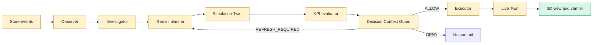

# RetailTwin AI

**Context-Guarded Autonomous 3D Retail Digital Twin**

> New to the project? Start with **[Project Context](docs/PROJECT_CONTEXT.md)**, then read **[Current Status](docs/CURRENT_STATUS.md)** before touching the code. Project Context describes the target product; Current Status says what is actually implemented on `main` today.

RetailTwin AI is an autonomous retail-operations system built around a live 3D Digital Twin. Store events trigger an AI control loop that gathers evidence, plans bounded actions, tests them in an isolated Simulation Twin, validates the selected decision with a deterministic Decision Context Guard (DCG), applies only authorized actions to the Live Twin, and verifies the result.

**This is not a chatbot project.** Chat can be an optional interface, but the primary product is event-driven autonomous operation.

## Canonical control loop

```text
OBSERVE → DETECT → INVESTIGATE → PLAN → SIMULATE → GUARD → ACT → VERIFY
```

Competition story:

```text
EVENT → AI → INVESTIGATE → SIMULATE → GUARD → LIVE 3D ACTION → VERIFY
```

## Why it matters

Retail conditions can change between the moment an AI makes a decision and the moment that decision reaches a live system. RetailTwin AI therefore binds decisions to exact context/evidence versions and rechecks them immediately before commit. If relevant state changed, **No-Stale-Commit** blocks the old decision and the agent refreshes/replans.

> **The LLM never owns the store state. The Digital Twin owns the truth; Gemini reasons over that truth and acts only through constrained tools.**

## Read the project in this order

1. **[PROJECT_CONTEXT.md](docs/PROJECT_CONTEXT.md)** — what we are building, the retail problem, product behavior, scope, application and glossary.
2. **[CURRENT_STATUS.md](docs/CURRENT_STATUS.md)** — what is implemented on `main`, what is in progress, what remains planned, and current gate status.
3. **[ARCHITECTURE.md](docs/ARCHITECTURE.md)** — target system components, Google Cloud stack, Simulation Twin, DCG, execution and security.
4. **[DOMAIN_AND_DATA_MODEL.md](docs/DOMAIN_AND_DATA_MODEL.md)** — target Store/Zone/Shelf/Slot/Product model, events, evidence, tools, actions and KPIs.
5. **[IMPLEMENTATION_GUIDE.md](docs/IMPLEMENTATION_GUIDE.md)** — role ownership, critical path, phases, gates and scope-reduction rules.
6. **[DEVELOPMENT_WORKFLOW.md](docs/DEVELOPMENT_WORKFLOW.md)** — issue/branch/PR workflow, verification and merge-safety rules.
7. **[DEMO_AND_ACCEPTANCE.md](docs/DEMO_AND_ACCEPTANCE.md)** — flagship scenario, stale-context test, 20-run Submission Gate and final demo.
8. **[docs/adr/](docs/adr/README.md)** — architecture decision log. Pull requests name the ADR they track.
9. **GitHub Issues** — implementation-ready work tickets with dependencies, verification and Definition of Done.

## Architecture at a glance



Green components are implemented or scaffolded in the current repository; yellow components remain planned or require integration evidence. A diagram is not a claim that a release gate has passed.

## Technology

- **AI:** Gemini on Vertex AI; Google ADK optional for specialized orchestration.
- **Frontend:** React + TypeScript + React Three Fiber / Three.js.
- **Backend:** Python + FastAPI on Cloud Run.
- **Live Digital Twin:** Firestore.
- **Analytics/history:** BigQuery.
- **Events:** Pub/Sub.
- **Assets:** Cloud Storage.
- **Authentication:** Firebase Authentication when enabled.
- **Guard:** deterministic Decision Context Guard.
- **3D assets:** primitive/low-poly first; GLB/glTF/Blender polish later.

## Repository layout

```text
apps/          web + API
agents/        orchestrator, observer, investigator, planner, simulator, executor, verifier
guard/         Decision Context Guard
services/      twin, simulation, optimizer, forecasting
data/          schemas, synthetic scenarios, seed
infrastructure/ GCP + Firebase
assets/        3D assets
docs/          project context, architecture, domain model, implementation, demo, adr/
tests/         unit, integration and E2E
.github/       workflows
```

## Flagship scenario

The primary scenario is **Weekend Demand Surge**. A SKU starts selling faster than expected. The agent autonomously investigates inventory/shelf/demand evidence, generates candidate shelf/replenishment plans, simulates them, selects a trade-off and sends the decision to DCG. The demo deliberately changes relevant context before the first commit so DCG blocks the stale decision. The agent refreshes and replans automatically; a valid new decision is authorized, executed on the Live Twin, rendered in 3D and verified.

## MVP non-negotiables

1. Autonomous trigger — no prompt is required.
2. Gemini reasoning uses real constrained tools.
3. AI actions visibly modify a state-backed 3D Digital Twin.
4. Simulation happens before live execution.
5. DCG / No-Stale-Commit protects Live Twin.
6. A valid guarded action reaches Live Twin and is verified.

## Delivery levels

**MVP-SAFE:** one reliable autonomous scenario with Simulation + DCG + live 3D commit.  
**SUBMISSION-80:** complete loop, strong UI/evidence, recovery/replan, deployment and submission artifacts.  
**COMPETITION-100:** optional multi-agent ADK, advanced optimizer, richer 3D/traffic, rollback or vision only after stability.

The Submission Gate requires the flagship scenario to pass **20 consecutive E2E runs** before optional Competition-100 work is allowed.

## Run the day-0 API locally

The web client reads health, store, and inventory from `apps/api`. The API serves the committed fixture in `data/schemas/store-state.example.json`. It does not use GCP credentials and it does not mutate live inventory. This local boundary does not close foundation gate #10.

- API setup and endpoints: [apps/api/README.md](apps/api/README.md)
- Web client: [apps/web/README.md](apps/web/README.md)
- Copy [.env.example](.env.example) to `.env` only to override hosts or ports. Do not commit `.env`.

## Google Cloud foundation

The shared project is `retailtwin-ai-511002` in `us-central1`. Day-0 resources stay inside the always-free limits. The setup and the cost rules are in [infrastructure/gcp/README.md](infrastructure/gcp/README.md). The local API still does not use GCP credentials.

## Current maturity

The architecture below is the **target product architecture**. For the exact implementation state of the repository, including open integration work and unpassed gates, read [docs/CURRENT_STATUS.md](docs/CURRENT_STATUS.md).

## Contribution rule

Before starting an issue, read its dependencies, [docs/CURRENT_STATUS.md](docs/CURRENT_STATUS.md), [docs/DEVELOPMENT_WORKFLOW.md](docs/DEVELOPMENT_WORKFLOW.md), and the relevant architecture documents above. If implementation changes a public schema, state transition, tool/action contract or security invariant, update the corresponding documentation in the same change and add or supersede an ADR in [docs/adr/](docs/adr/README.md). Every pull request names the ADR it tracks, or marks `N/A` when the change has no architectural effect.
