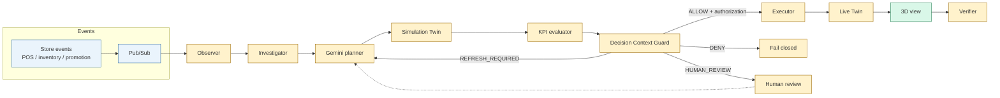

# RetailTwin AI — Technical Architecture

## 1. Architecture objective

> This document is the **target architecture**. It does not imply every component is already implemented. See `docs/CURRENT_STATUS.md` for the current `main` baseline and gate status.

RetailTwin AI must autonomously react to retail events while preserving a strict boundary between AI reasoning and live operational state.

High-level path:

```text
POS / Inventory / Promotion / Demo Events
                 |
              Pub/Sub
                 |
             Observer
                 |
           Investigator
                 |
        Gemini Planner/Orchestrator
                 |
        Candidate Action Plans
                 |
          Simulation Service
          /       |        \
     Scenario A Scenario B Scenario C
          \       |        /
          KPI Evaluator
                 |
          Selected Decision
                 |
       Decision Context Guard
          |       |       |
        DENY   REFRESH   ALLOW
                  |        |
               Re-plan   Commit Authorization
                           |
                        Executor
                           |
                       Live Twin
                           |
                    3D Visualization
                           |
                        Verifier
```

## 2. Architecture end-to-end flow (planned vs implemented)



Gate posture (per `docs/CURRENT_STATUS.md`): all gates **pending** — no linked test, deployment, or 20-run evidence was available in the checked-out repository.

## 2. Technology stack

### Frontend
- React + TypeScript
- React Three Fiber / Three.js + Drei
- GLB/glTF assets where useful
- Firebase Hosting or appropriate Google Cloud deployment

### Backend
- Python
- FastAPI
- Cloud Run

### AI and orchestration
- Gemini on Vertex AI for evidence-grounded planning and explanation
- Google ADK is optional for specialized multi-agent orchestration after the single-orchestrator MVP is stable
- Structured tool/function calling only

### Operational data
- Firestore: current Live Twin and simulation branch metadata/state
- BigQuery: sales history, inventory history, analytical features, action/audit history
- Pub/Sub: event-driven activation
- Cloud Storage: 3D/static assets
- Secret Manager: runtime secrets where required
- Cloud Logging: technical logs
- Firebase Authentication: role/user authentication when enabled

### LLM Provider Architecture
The inference layer uses a **provider-neutral contract** in `apps/api/retailtwin_api/llm/contracts.py`.
All adapters implement `LlmProvider.complete(request: LlmRequest) -> LlmResponse`.

| Provider | Config | Credentials | Notes |
|---|---|---|---|
| `fake` | `LLM_PROVIDER=fake` | None | Deterministic; for tests, local dev, CI |
| `openai_compatible` | `LLM_PROVIDER=openai_compatible` | `LLM_BASE_URL`, `LLM_API_KEY` | Local proxies, OpenAI, Azure |
| `vertex_gemini` | `LLM_PROVIDER=vertex_gemini` | GCP ADC | Production Gemini on Vertex AI |

The fake provider is the default in `.env.example` and is the only provider used in CI.

## 3. Component responsibilities

### Observer
Consumes normalized store events, deduplicates, preserves correlation IDs and starts an investigation without a human prompt.

### Investigator
Collects bounded, versioned evidence. It does not make up missing facts.

### Planner / Orchestrator
Uses Gemini to interpret evidence and produce structured candidate plans. Only allow-listed action schemas are legal.

### Simulation Service
Clones the relevant live state into an isolated simulation state and applies candidate actions there.

### KPI Evaluator
Computes business/operational effects. Values must be deterministic or model-derived.

### Decision Context Guard
Rechecks the proposed decision immediately before live commit. It is deterministic enforcement, not an LLM.

### Executor
The only application component that performs authorized live mutations. It requires a valid short-lived authorization bound to the decision/context/actions.

### Verifier
Reads post-action state and compares expected versus observed outcome.

### 3D Digital Twin
Displays Live or Simulation state. It is a state-driven operational interface, not an animation detached from backend truth.

## 4. Decision Context Guard

A Decision should contain at least:

```json
{
  "decision_id": "RT-D-1027",
  "agent_id": "retailtwin-orchestrator",
  "context_version": "store-001:v23871",
  "context_timestamp": "2026-10-07T08:00:00Z",
  "evidence": [],
  "proposed_actions": [],
  "simulation_id": "SIM-204",
  "expected_impact": {}
}
```

MVP gates:
1. **Decision integrity** — required fields/actions are valid.
2. **Context version** — relevant live entity versions still match.
3. **Freshness** — evidence/decision is within allowed TTL.
4. **Physical/business constraints** — inventory and shelf capacity are valid.
5. **Authorization/policy** — action is allowed for this autonomous mode.

Possible outcomes:
- `ALLOW`
- `DENY`
- `REFRESH_REQUIRED`
- `HUMAN_REVIEW`

### No-Stale-Commit

```text
Decision built at store version v23871
             |
     live context changes
             v
Current version v23879
             |
            DCG
             |
      REFRESH_REQUIRED
             |
 refresh evidence → new decision → simulate → DCG again
```

No valid authorization means no Live Twin mutation.

## 5. Commit authorization

After `ALLOW`, DCG/authorization service issues a short-lived authorization containing or referencing:
- decision ID;
- context hash/version;
- exact allowed action set/action hashes;
- expiry;
- optional nonce/replay protection.

Executor rejects missing, expired, reused or action-mismatched authorization.

## 6. State separation

**Live state and Simulation state must never share an unsafe mutation path.**

Simulation:
`Live snapshot/version → clone → simulation actions → KPI → discard/retain result`

Live:
`Decision → DCG → authorization → Executor → Live state`

The UI must clearly label LIVE versus SIMULATION.

## 7. Action risk

Suggested policy:
- **L1 / observation:** focus camera, highlight, read/analyze — automatic.
- **L2 / simulation:** move SKU, facings, planogram changes in Simulation Twin — automatic.
- **L3 / live low-risk:** bounded replenishment/layout action — autonomous only if policy permits and DCG passes.
- **High-risk business action:** price/promotion or other sensitive action — `HUMAN_REVIEW` unless explicitly permitted by competition policy configuration.

## 8. Reliability rules

- Pub/Sub events carry `event_id` and `correlation_id`.
- Consumers are idempotent where possible.
- Retries are bounded.
- Agent re-planning is bounded.
- Errors are visible; no silent live commit.
- Demo reset is deterministic.
- Structured logs preserve correlation/decision/simulation/action IDs.

## 9. Security rules

- No service-account key or secret in Git.
- Use service identities/IAM and Secret Manager as appropriate.
- Frontend cannot bypass backend guard/executor.
- Gemini never receives raw database credentials.
- Validate all tool arguments server-side.
- Live write APIs are not general-purpose public mutation endpoints.
- Audit live decisions/actions without storing hidden chain-of-thought.

## 10. Repository ownership map

```text
apps/web                         3D + UX
apps/api                         API/integration boundary
agents/orchestrator              autonomous state machine
agents/observer                  event activation
agents/investigator              evidence gathering
agents/planner                   structured plans
agents/simulator                 simulation orchestration
agents/executor                  guarded execution
agents/verifier                  post-action verification
guard/decision-context-guard     deterministic live-action guard
services/twin                    canonical twin access
services/simulation              clone/apply/evaluate
services/optimizer               optional candidate optimizer
services/forecasting             demand/risk services
data/*                           schemas, seed, synthetic scenarios
infrastructure/*                 GCP/Firebase configuration
tests/*                          unit/integration/E2E
```
