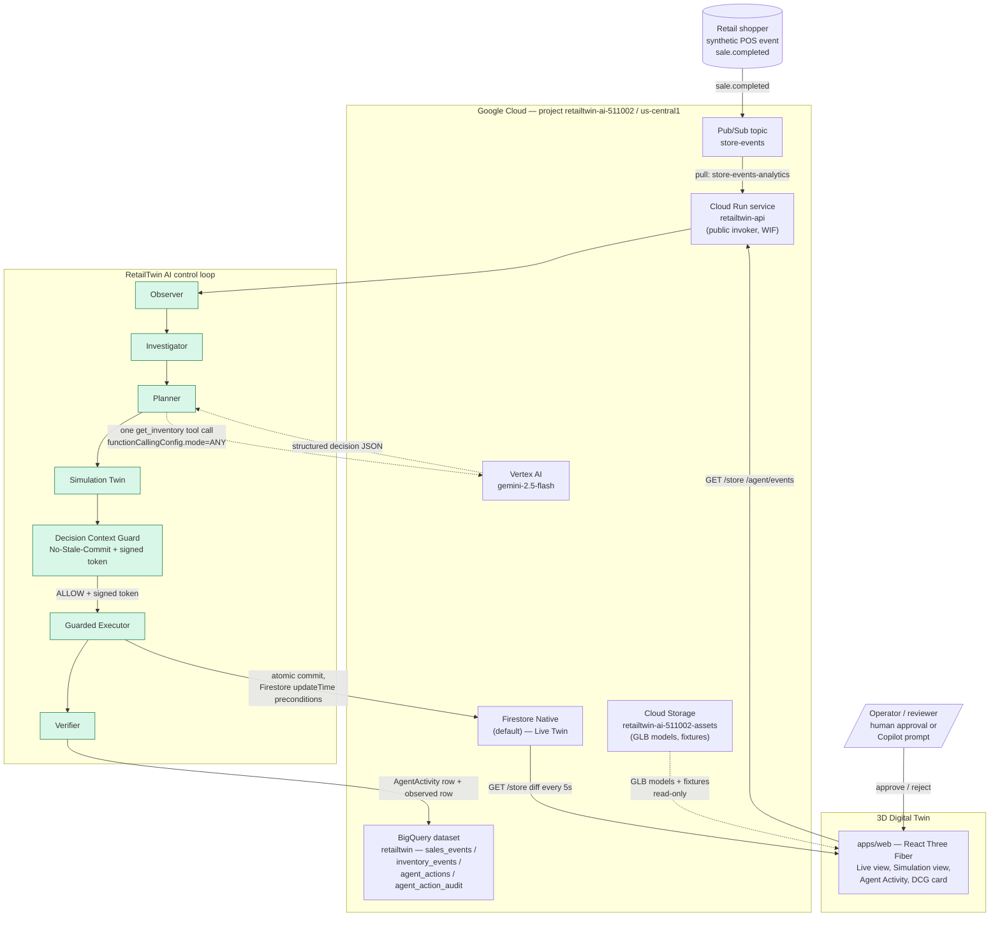
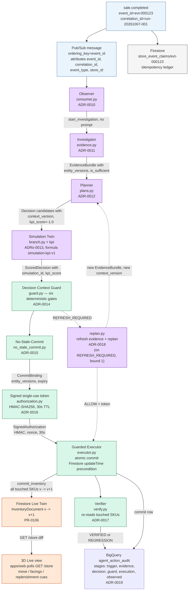
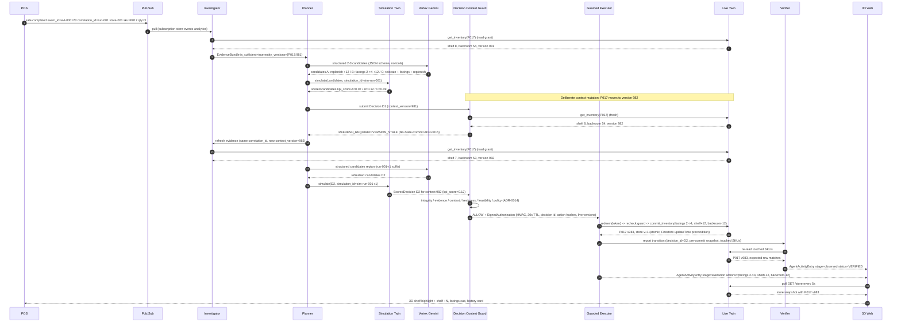
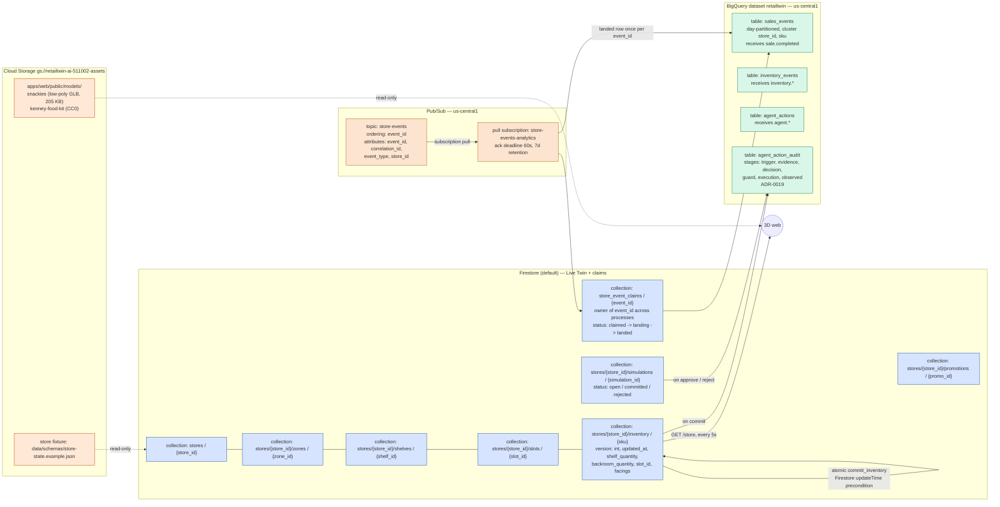

# RetailTwin AI — Architecture Diagram

> **Purpose.** This document distills the canonical architecture of RetailTwin AI into four Mermaid diagrams. It is the **diagram half** of issue [#46](../README.md): one self-contained Mermaid block per layer, renderable on GitHub and in VS Code without extensions.
>
> **Audience.** Submission reviewers, new contributors, and judges who want a single-page map of the system before reading the deeper docs.
>
> **Authoritative sources.** All diagrams are derived from `docs/PROJECT_CONTEXT.md`, `docs/ARCHITECTURE.md`, `docs/DOMAIN_AND_DATA_MODEL.md`, `docs/CURRENT_STATUS.md`, `docs/CLOUD_RUNTIME_MATRIX.md`, and the ADRs in `docs/adr/`. When this file disagrees with those, the source docs win. See `docs/SUBMISSION_INDEX.md` for a quick pointer map.

---

## 1. System context — who talks to whom

This is the bird's-eye view: an external store event or operator command enters through the Google Cloud boundary, the RetailTwin AI control loop returns a guarded live mutation, and the 3D Twin surfaces the result.

**Read it left-to-right**: a synthetic POS event enters Pub/Sub; the Cloud Run API consumes it through the seven-stage control loop; mutations are committed to Firestore only through the guarded Executor; BigQuery holds the audit trail; the 3D Twin reflects the Live state. The Gemini inference path is dotted because it is one constrained tool call, not a free-form chat.

---

## 2. End-to-end data flow — eight stages, one correlation id

Every autonomous run shares a single `correlation_id` from the originating `StoreEvent` so it can be traced end-to-end through logs, decisions, simulations, the guard audit, and the BigQuery trail.

**Key invariants shown in the diagram**

- The simulator and DCG are the **only** paths into live state; Gemini never reaches Firestore directly.
- REFRESH_REQUIRED is the one signal that re-enters the loop; every other guard verdict ends the run.
- `kpi_score = -1.0` is the unscored sentinel until `simulation-kpi-v1` writes a real number.
- The Verifier never trusts the Executor's return value — it re-reads the Live Twin row by row.

---

## 3. Sequence diagram — one flagship run with eight stages

This is the signature run: a `sale.completed` triggers the agent, the Live Twin version moves between planning and commit, the Decision Context Guard (DCG) blocks the stale decision, the agent refreshes evidence and replans, the new decision passes, the guarded Executor commits, and the Verifier confirms the result.

**Three reasons this diagram is the canonical one**

1. It shows the **stale branch live**: `REFRESH_REQUIRED` lands, a refresh is triggered without a human, and only D2 reaches the guarded commit.
2. It shows **why Gemini cannot write Live state**: the only model call (`structured candidates`) has no live tools; the only `Live Twin` write goes through `executor.commit_inventory` behind a signed token.
3. It shows **why the result is auditable**: every stage carries the same `correlation_id` and emits one BigQuery `agent_action_audit` row plus one `AgentActivityEntry` for judges.

---

## 4. Storage layout — Firestore, BigQuery, Pub/Sub

Operational state lives in Firestore, history in BigQuery, transport in Pub/Sub. Every mutable entity has a version and an `updated_at` so the DCG can detect staleness deterministically. See `docs/CLOUD_RUNTIME_MATRIX.md` for exact resource names.

**Two data-plane rules the diagram encodes**

- **Firestore owns truth.** BigQuery rows are an analytical projection keyed by `event_id`. A row that bypasses the Pub/Sub lander is not deleted; it is left in place, and the claim is marked `landed` (ADR 0005).
- **Mutable entities carry versions.** Every `inventory` document, the `stores` document, and every `simulation` document has a `version` integer and `updated_at`; the DCG refuses any action whose evidence version no longer matches the live read.

---

## 5. Reading order

1. `docs/SUBMISSION_INDEX.md` — one-page pointer map for judges.
2. `docs/PROJECT_CONTEXT.md` §4 — the **Weekend Demand Surge** scenario this whole architecture is shaped around.
3. `docs/ARCHITECTURE.md` — the narrative counterpart to this file (more prose, less pixel).
4. `docs/CURRENT_STATUS.md` — what is on `main` today vs what is the target architecture.
5. `docs/adr/` — every novel invariant is recorded as a `0001`-`0023` ADR (plus `0037` for the timeline).
