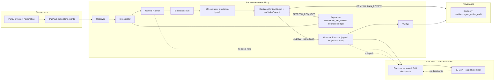

# RetailTwin AI — Competition README

> Long-form technical brief for judges. The 1-screen judge version is [README.md](../README.md); this document is the deep dive.

## Table of contents

1. [Product positioning](#1-product-positioning)
2. [Architecture deep dive](#2-architecture-deep-dive)
3. [The 8-stage autonomous control loop](#3-the-8-stage-autonomous-control-loop)
4. [Storage layout: Firestore + BigQuery + Pub/Sub](#4-storage-layout-firestore--bigquery--pubsub)
5. [Flagship scenario: Weekend Demand Surge](#5-flagship-scenario-weekend-demand-surge)
6. [Safety stack: DCG, No-Stale-Commit, signed authorization, Verifier](#6-safety-stack)
7. [Google AI and Google Cloud usage](#7-google-ai-and-google-cloud-usage)
8. [Setup, run, deploy](#8-setup-run-deploy)
9. [Gate evidence index](#9-gate-evidence-index)
10. [Performance numbers from recent runs](#10-performance-numbers-from-recent-runs)
11. [Limitations and what is not yet on main](#11-limitations-and-what-is-not-yet-on-main)

## 1. Product positioning

RetailTwin AI is an **autonomous retail-operations system** built around a live 3D Digital Twin. It is not a chatbot and the 3D scene is not a decoration. The store is represented as machine-readable state: zones, shelves, slots, products, inventory, sales signals, promotions, and operational constraints. A real event — a sale spike, an inventory change, a promotion — drives the loop. No human prompt is required.

```text
RetailTwin AI = Store data + 3D Digital Twin + Autonomous AI Agent
                + Simulation + Context-Guarded Execution
```

The defining property is **safety at the commit moment**: every autonomous action is simulated, validated by a deterministic guard against current Live Twin state, and re-validated immediately before any mutation. A plan that was valid at time T but stale at T+1 is refused, and the agent automatically refreshes evidence and replans.

## 2. Architecture deep dive

The system is one deterministic state machine with bounded LLM reasoning at two points only: candidate plan generation and the post-action summary. Everything else — observation, evidence, simulation, scoring, guarding, authorization, execution, verification, audit — is deterministic and individually testable.



Three boundaries are enforced by code, not policy:

1. **Gemini cannot write Live Twin state.** It calls allow-listed tools served by the registry, and the only writer of Live Twin state is the guarded Executor ([ADR 0009](adr/0009-expose-one-allow-listed-tool-registry.md), [ADR 0016](adr/0016-commit-only-through-a-signed-single-use-authorization.md)).
2. **Live and Simulation are isolated.** A simulation clones the live snapshot, applies candidate actions, scores the result, and never writes back. The Live Twin is mutated only after a guarded commit ([ADR 0013](adr/0013-score-candidate-plans-on-a-simulation-clone.md)).
3. **Quantitative values come from code, not the LLM.** KPI scores, stockout risk, demand forecast, and feasibility are computed deterministically. Gemini explains; it does not invent numbers.

The full target architecture is in [docs/ARCHITECTURE.md](ARCHITECTURE.md). The canonical autonomous control loop diagram is being delivered in parallel in [docs/architecture/README.md](architecture/README.md) (issue #46).

### 2.1 Component responsibilities

| Component | Responsibility | ADR |
|---|---|---|
| **Observer** | Consume normalized events, deduplicate, start one investigation per accepted `sale.completed`. | [0010](adr/0010-start-one-investigation-per-sale.md) |
| **Investigator** | Collect bounded, versioned evidence through the tool registry. Never invent missing facts. | [0011](adr/0011-collect-versioned-evidence-from-the-tool-registry.md) |
| **Planner** | Ask Gemini for two or three structured candidate actions, validate them against the observed SKU/slot/backroom, bind `context_version` and `context_timestamp`. | [0012](adr/0012-bind-candidate-plans-to-the-evidence-context.md) |
| **Simulation Twin** | Apply candidate actions to a clone, score each with the deterministic `simulation-kpi-v1` formula. Never write the Live Twin. | [0013](adr/0013-score-candidate-plans-on-a-simulation-clone.md) |
| **Decision Context Guard** | Run six deterministic gates in order; first failure decides. Read the Live Twin, never write it. | [0014](adr/0014-guard-each-decision-with-deterministic-gates.md) |
| **No-Stale-Commit** | Wrap the guard so a decision built at version N is refused if a touched SKU is at N+1. Issue short-lived `CommitBinding`. | [0015](adr/0015-recheck-live-versions-before-every-commit.md) |
| **Guarded Executor** | Redeem an HMAC-signed single-use authorization, recheck the guard, and write every touched SKU plus the store version step in one atomic Firestore commit. | [0016](adr/0016-commit-only-through-a-signed-single-use-authorization.md) |
| **Verifier** | Re-read each touched SKU through the Live Twin and report `VERIFIED` / `REGRESSION` / `INCONCLUSIVE`. | [0017](adr/0017-verify-post-action-state-by-rereading-live-inventory.md) |
| **Replan orchestrator** | On `REFRESH_REQUIRED`, refresh evidence and replan under `RETAILTWIN_REPLAN_MAX_REFRESHES`. | [0018](adr/0018-refresh-evidence-and-replan-after-a-stale-rejection.md) |
| **Agent action audit** | One `agent_action_audit` row per stage, correlated by `correlation_id`. | [0019](adr/0019-record-agent-action-provenance-in-bigquery.md) |
| **Provider registry** | Registered adapters (`fake`, `openai_compatible`, `vertex_gemini`); production constructs only `vertex_gemini` on `retailtwin-ai-511002` in `us-central1` with ADC. | [0020](adr/0020-register-llm-providers-and-require-vertex-adc-in-production.md) |
| **Live Gemini read** | `read_inventory` calls `get_inventory` exactly once; the typed Live Twin document is the result. | [0021](adr/0021-require-one-gemini-inventory-read.md) |

## 3. The 8-stage autonomous control loop

The flagship scenario is `sale.completed` for SKU `P017` on `store-001` during a weekend demand surge. Below is each stage, the module that owns it, the data structure that crosses the boundary, and the ADR that records the decision.

### 3.1 OBSERVE — normalized event lands

- **Where:** Pub/Sub topic `store-events` → `store-events-analytics` subscription → `apps/api/retailtwin_api/agents/observer/consumer.py`.
- **Data:** a normalized `StoreEvent` with `event_id`, `correlation_id`, `event_type`, `store_id`, `sku`, `quantity`, `occurred_at`, `source`.
- **Invariant:** one `event_id` claims one immutable payload in Firestore `store_event_claims/{event_id}`. A replay is a duplicate. A different payload returns `event_id_conflict` and does not replace the claim or the row ([ADR 0005](adr/0005-land-each-normalized-store-event-once.md)).
- **Gate:** the event is acknowledged only after the claim is committed; a rejected message is written to `store_event_rejects` before ack.

### 3.2 DETECT — start one investigation per accepted sale

- **Where:** the Observer hands the accepted `StoreEvent` to an injected `start_investigation` call. The handoff carries the original event plus an `inv-` prefixed `event_id` ([ADR 0010](adr/0010-start-one-investigation-per-sale.md), [ADR 0023](adr/0023-start-investigations-from-accepted-sales.md)).
- **Invariant:** the same payload is a duplicate. A different payload is a conflict and does not replace the first event. The analytics lander is unchanged.
- **Configuration:** controlled by `AUTONOMY_ENABLED` (default off; `true` for the demo).

### 3.3 INVESTIGATE — versioned evidence

- **Where:** `apps/api/retailtwin_api/agents/investigator/` reads through the allow-listed tool registry ([ADR 0009](adr/0009-expose-one-allow-listed-tool-registry.md), [ADR 0011](adr/0011-collect-versioned-evidence-from-the-tool-registry.md)).
- **Read tools served today by the store registry:** `get_inventory`, `get_store_state`, `get_shelf_state`, `get_backroom_inventory`.
- **Data:** an `EvidenceBundle` carries `context_version`, `collected_at`, and a list of `items` where each item has a `type`, an `entity_id`, the `version` it was read at, and a `value`.
- **Invariant:** every bundle must come from one store, carry one `correlation_id`, and report `is_sufficient`. Insufficient evidence is a controlled `INSUFFICIENT_EVIDENCE` outcome, not silent guessing.

### 3.4 PLAN — bounded Gemini candidate plans

- **Where:** `apps/api/retailtwin_api/agents/planner/plans.py`.
- **What:** the planner asks the injected provider for two or three structured candidate actions, validates them against the observed SKU, slot, and backroom, and binds `context_version`, `context_timestamp`, and the evidence ([ADR 0012](adr/0012-bind-candidate-plans-to-the-evidence-context.md)).
- **Invariant:** the planner never imports a model SDK, never writes the Live Twin, and leaves `expected_impact.kpi_score` at `-1.0` until the simulator scores the candidate.

### 3.5 SIMULATE — score on a clone

- **Where:** `apps/api/retailtwin_api/agents/simulator/branch.py` plus the deterministic `services/simulation` evaluator.
- **What:** each `Decision` is applied to a clone of the relevant Live Twin snapshot, the `simulation-kpi-v1` formula is computed, and the result is stored by `simulation_id` ([ADR 0013](adr/0013-score-candidate-plans-on-a-simulation-clone.md)).
- **Invariant:** the simulation id is `sim-` plus the correlation id. The same actions repeat the stored result. The Live Twin is not touched and the model SDK is not imported.

### 3.6 GUARD — DCG + No-Stale-Commit

- **Where:** `apps/api/retailtwin_api/guard/decision_context_guard/`.
- **What:** six deterministic gates run in order and the first failure decides ([ADR 0014](adr/0014-guard-each-decision-with-deterministic-gates.md), [ADR 0015](adr/0015-recheck-live-versions-before-every-commit.md)):
  1. **Integrity** — required fields, one store, one correlation id, no action-type repeats per SKU, timezones aware.
  2. **Evidence** — every bundle is `is_sufficient`; bundles agree on each SKU version.
  3. **Context version** — for each touched SKU, the live version must equal the evidence version. A drift is `REFRESH_REQUIRED VERSION_STALE`. An unknown SKU is `DENY UNKNOWN_ENTITY`. An evidence without a version is `DENY MISSING_CONTEXT_VERSION`.
  4. **Freshness** — oldest of `context_timestamp` and bundle `freshness` ≤ `RETAILTWIN_DCG_FRESHNESS_SECONDS` (default 120). Otherwise `REFRESH_REQUIRED CONTEXT_EXPIRED`.
  5. **Physical feasibility** — replenishment ≤ backroom; facings ≤ `RETAILTWIN_DCG_MAX_FACINGS` (default 12); a move must start from the SKU's current slot and end in a different, unoccupied slot.
  6. **Policy** — action type in `allowed_actions`; ≤ `RETAILTWIN_DCG_MAX_ACTIONS` (default 5); replenishment ≤ `RETAILTWIN_DCG_MAX_REPLENISH_UNITS` (default 200). Past the limits, `HUMAN_REVIEW`; outside the list, `DENY ACTION_NOT_ALLOWED`.
- **Invariant:** the guard reads the Live Twin, never writes it, and imports no model SDK. Any exception from a Live Twin read is `DENY TWIN_UNAVAILABLE`, and the exception text is not copied into the result. `context_hash` is the SHA-256 of canonical JSON over the decision id, store, live versions, and canonical actions.

### 3.7 ACT — guarded commit

- **Where:** `apps/api/retailtwin_api/agents/executor/executor.py` ([ADR 0016](adr/0016-commit-only-through-a-signed-single-use-authorization.md)).
- **What:** the `CommitAuthorizer` issues a `SignedAuthorization` only from a `CommitBinding`. The token binds:
  - the decision id and the store;
  - the context hash;
  - the SHA-256 of each canonical action, in order;
  - the live version of every touched SKU;
  - a 128-bit nonce;
  - issue time and expiry (`RETAILTWIN_COMMIT_TOKEN_TTL_SECONDS`, default 30, never past the binding's expiry).
- **Token:** HMAC-SHA256 under `RETAILTWIN_COMMIT_SIGNING_KEY`. In production without a key, nothing is issued. Outside production, a random per-process key is generated and a warning is logged.
- **Commit steps:** redeem → `NoStaleCommit.recheck` on fresh reads → re-read each touched SKU and refuse with `VERSION_STALE` if any is not at the token's version → call `LiveTwinRepository.commit_inventory` once with every touched SKU and the store `v<N>` step, atomic at the repository boundary (Firestore `:commit` with `updateTime` preconditions, in-memory under the repository lock).
- **Failures:** a missing, tampered, expired, reused, or action-mismatched token changes nothing. A `TwinConflict` is `VERSION_STALE`. Any other failure is `EXECUTION_FAILED`. There is no partial commit and no rollback.

### 3.8 VERIFY — re-read live inventory

- **Where:** `apps/api/retailtwin_api/agents/verifier/verify.py` ([ADR 0017](adr/0017-verify-post-action-state-by-rereading-live-inventory.md)).
- **What:** the Verifier re-reads each SKU a decision's actions touch and compares the live row with the transition the actions imply from the pre-commit snapshot:
  - `replenish_shelf` adds the quantity to the shelf and subtracts it from the backroom;
  - `change_facings` replaces the facing count;
  - `move_product` changes only `slot_id`.
- **Result:** `VERIFIED`, `REGRESSION`, or `INCONCLUSIVE`. `kpi_score` of `-1.0` is the planner's unscored sentinel and is not compared.
- **Invariant:** the Verifier does not call the KPI evaluator again, does not write the Live Twin, and does not import a model SDK. A process-memory audit event stores the decision id, correlation id, status, reason, and SKUs.

### 3.9 Recover — bounded replan

If the guard returns `REFRESH_REQUIRED`, the orchestrator discards the binding, calls the injected provider through `investigate` and `plan` with the same correlation id and store id, reads the context version source again for the new decision, and re-submits under `RETAILTWIN_REPLAN_MAX_REFRESHES` (default 1) ([ADR 0018](adr/0018-refresh-evidence-and-replan-after-a-stale-rejection.md)). A provider, planner, simulation, or commit failure stops the run without another refresh and without a second live attempt. The production composition root binds the failure-recovery contract end-to-end ([issue #214](https://github.com/vinhphan812/retailtwin-ai/issues/214)).

## 4. Storage layout: Firestore + BigQuery + Pub/Sub

The three storage systems have a single responsibility each. BigQuery rows are history, not a second Live Twin. The day-0 event-id owner is the Firestore document `store_event_claims/{event_id}`. The layout, names, regions, and IAM roles are in [docs/CLOUD_RUNTIME_MATRIX.md](CLOUD_RUNTIME_MATRIX.md).

### 4.1 Firestore (Live Twin, operational state)

Database `(default)` on `retailtwin-ai-511002` in `us-central1`, Native mode, Standard edition.

| Path | Purpose | Owner |
|---|---|---|
| `inventory/{sku}` | Versioned SKU document. The `version` integer and the `updated_at` timestamp are the freshness token for DCG. Each `updateTime` precondition matches Firestore's atomic-commit semantics. | Issue #6 / PR #106 |
| `store_event_claims/{event_id}` | Idempotency claim. A landing lease chooses who may submit the derived insert. | [ADR 0005](adr/0005-land-each-normalized-store-event-once.md) |
| `store_event_rejects` | Quarantined messages that were not acknowledged. | [ADR 0005](adr/0005-land-each-normalized-store-event-once.md) |
| `decisions/{decision_id}` (future) | Durable Decision source for the approve route. | Issue #217 (in flight) |
| `simulations/{simulation_id}` (future) | Durable SimulationRepository. | Issue #217 |
| `agent_activity/{correlation_id}` (future) | Durable AgentActivityLog. | Issue #217 |
| `activation_ledger/{activation_id}` (future) | Durable ActivationLedger. | Issue #217 |

Every mutable entity that DCG can check has `version` and `updated_at`.

### 4.2 BigQuery (analytics and history)

Dataset `retailtwin` in `us-central1`, on-demand, no reservation.

| Table | Purpose | Owner |
|---|---|---|
| `sales_events` | One row per accepted `sale.completed`. | [ADR 0005](adr/0005-land-each-normalized-store-event-once.md) |
| `inventory_events` | One row per accepted `inventory.*`. | [ADR 0005](adr/0005-land-each-normalized-store-event-once.md) |
| `agent_actions` | One row per accepted `agent.*`. | [ADR 0005](adr/0005-land-each-normalized-store-event-once.md) |
| `agent_action_audit` | One row per stage (`trigger`, `evidence`, `decision`, `guard`, `execution`, `observed`), correlated by `correlation_id`. A denial has no execution or observed row. `-1.0` is the unscored `kpi_score` sentinel. | [ADR 0019](adr/0019-record-agent-action-provenance-in-bigquery.md) |

The audit table is created only by `infrastructure/gcp/apply-agent-action-audit.sh` when `CONFIRM_GCP_AGENT_AUDIT=yes`. Writes use `NOT EXISTS` on `record_id` so a repeat payload is a duplicate and a different payload does not replace the row. No streaming insert, no route.

### 4.3 Pub/Sub (event backbone)

| Resource | Exact name | Owner |
|---|---|---|
| Topic | `store-events` in `us-central1` (message storage is region-bound) | [ADR 0005](adr/0005-land-each-normalized-store-event-once.md) |
| Subscription | `store-events-analytics` (pull consumer) | [ADR 0005](adr/0005-land-each-normalized-store-event-once.md) |

Every published message carries the attributes `event_id`, `correlation_id`, `event_type`, and `store_id`. The `correlation_id` is copied onto the table row.

## 5. Flagship scenario: Weekend Demand Surge

The flagship end-to-end scenario is `Weekend Demand Surge` on `store-001` / `P017`. The full sequence, the Mermaid diagram, and the judge-visible evidence are in [docs/DEMO_AND_ACCEPTANCE.md §8](DEMO_AND_ACCEPTANCE.md#8-weekend-demand-surge-sequence-stale-context-protected). The storyboard, the stale-context acceptance, and the 20-run Submission Gate are in the same file.

## 6. Safety stack

| Mechanism | Where | Why it exists | ADR |
|---|---|---|---|
| Deterministic tool registry | `apps/api/retailtwin_api/agents/orchestrator/tool_registry.py` | Gemini can only call allow-listed tools. A live-write name is refused. | [0009](adr/0009-expose-one-allow-listed-tool-registry.md) |
| DCG — six deterministic gates | `apps/api/retailtwin_api/guard/decision_context_guard/` | Server-side enforcement before commit. First failure decides. | [0014](adr/0014-guard-each-decision-with-deterministic-gates.md) |
| No-Stale-Commit | `no_stale_commit.py` | Re-run the guard immediately before commit; refuse when a touched SKU version changed. | [0015](adr/0015-recheck-live-versions-before-every-commit.md) |
| HMAC-signed single-use authorization | `authorization.py` | Bind the token to the exact decision, context hash, action hashes, and live versions. | [0016](adr/0016-commit-only-through-a-signed-single-use-authorization.md) |
| Guarded Executor (only Live Twin writer) | `agents/executor/executor.py` | Redeem the token, recheck, and commit atomically. | [0016](adr/0016-commit-only-through-a-signed-single-use-authorization.md) |
| Verifier | `agents/verifier/verify.py` | Re-read each touched SKU and report `VERIFIED` / `REGRESSION` / `INCONCLUSIVE`. | [0017](adr/0017-verify-post-action-state-by-rereading-live-inventory.md) |
| Bounded replan | `agents/orchestrator/replan.py` | `RETAILTWIN_REPLAN_MAX_REFRESHES` bounds the recovery loop. | [0018](adr/0018-refresh-evidence-and-replan-after-a-stale-rejection.md) |
| Agent action audit | `audit/trail.py` | One correlated trace per autonomous run; no chain-of-thought, no credentials. | [0019](adr/0019-record-agent-action-provenance-in-bigquery.md) |
| Provider registry (Vertex-only in production) | `llm/factory.py` | Refuse a fake provider, a loopback endpoint, or an API key in production. | [0020](adr/0020-register-llm-providers-and-require-vertex-adc-in-production.md) |
| Live Gemini read | `agents/orchestrator/inventory_read.py` | `get_inventory` exactly once, named, `READ` granted, model prose ignored. | [0021](adr/0021-require-one-gemini-inventory-read.md) |

## 7. Google AI and Google Cloud usage

| Layer | Service | Configuration |
|---|---|---|
| LLM inference | Vertex AI — `gemini-2.5-flash` in `us-central1` on `retailtwin-ai-511002` | `LLM_PROVIDER=vertex_gemini`, `LLM_MODEL=gemini-2.5-flash`, `GOOGLE_CLOUD_PROJECT=retailtwin-ai-511002`, `GOOGLE_CLOUD_LOCATION=us-central1`. ADC only. [ADR 0020](adr/0020-register-llm-providers-and-require-vertex-adc-in-production.md). |
| Live Digital Twin | Firestore `(default)`, Standard, Native | `LIVE_TWIN_BACKEND=firestore` in production. `memory` for dev. `fixture` for the read-only day-0 API. |
| Analytics and history | BigQuery `retailtwin` in `us-central1` | `BIGQUERY_DATASET=retailtwin`, `BIGQUERY_LOCATION=us-central1`. The audit table is created only when `CONFIRM_GCP_AGENT_AUDIT=yes`. |
| Event backbone | Pub/Sub topic `store-events`, subscription `store-events-analytics` | `STORE_EVENTS_TOPIC`, `STORE_EVENTS_SUBSCRIPTION`. |
| API runtime | Cloud Run `retailtwin-api` in `us-central1` | `retailtwin-api@retailtwin-ai-511002.iam.gserviceaccount.com`. Minimum instances 0 by default, `--min-instances 1` in production. |
| CI/CD | Workload Identity Federation → `github-actions@retailtwin-ai-511002.iam.gserviceaccount.com` | `vars.GCP_WORKLOAD_IDENTITY_PROVIDER`, `secrets.GCP_DEPLOY_SA`, `secrets.GCP_RUNTIME_SA`. No long-lived JSON keys. |
| Static assets | Cloud Storage `gs://retailtwin-ai-511002-assets` | 3D models, decor. |
| Web hosting | Firebase Hosting `retailtwin-ai-511002.web.app` | Managed by `firebase-tools`, not by Terraform #99. |

The canonical resource table, with exact names, regions, IAM roles, environment variables, and verification commands, is in [docs/CLOUD_RUNTIME_MATRIX.md](CLOUD_RUNTIME_MATRIX.md). Terraform #99 will codify these resources; the day-0 state is verified by `scripts/verify-cloud-preflight.sh`.

## 8. Setup, run, deploy

### 8.1 Local development

```bash
# API
cd apps/api
pip install -e ".[dev]"

# Web
cd ../web
npm ci
```

Environment variables come from [`.env.example`](../.env.example). No service-account key, no Gemini API key, no Google API key. The day-0 API serves the committed fixture at `data/schemas/store-state.example.json` and does not use GCP credentials.

### 8.2 Against the real Live Twin

```bash
gcloud auth application-default login
gcloud config set project retailtwin-ai-511002
LIVE_TWIN_BACKEND=firestore AUTONOMY_ENABLED=true \
  LLM_PROVIDER=vertex_gemini LLM_MODEL=gemini-2.5-flash \
  APP_ENV=production \
  RETAILTWIN_COMMIT_SIGNING_KEY="$(openssl rand -hex 32)" \
  python -m retailtwin_api
```

The signing key is never committed. `register_provider` cannot replace or remove `vertex_gemini`; a fake provider, a loopback endpoint, and an API key are refused ([ADR 0020](adr/0020-register-llm-providers-and-require-vertex-adc-in-production.md)).

### 8.3 Deploy

```bash
scripts/deploy-cloudrun.sh        # API on Cloud Run retilttwin-api
scripts/deploy-web.sh             # Web on Firebase Hosting retailtwin-ai-511002.web.app
```

The deploy scripts are the source of truth. The full production contract is in [docs/CLOUD_RUNTIME_MATRIX.md](CLOUD_RUNTIME_MATRIX.md) and [scripts/deploy-cloudrun.sh](../scripts/deploy-cloudrun.sh).

### 8.4 Verify the foundation

```bash
./scripts/verify-cloud-preflight.sh
PYTHONPATH=apps/api python3 -m pytest apps/api/tests --no-header -q
```

The preflight script is read-only and prints no secret values.

## 9. Gate evidence index

Each release gate has a reproducible runnable evidence harness. The harness builds the real app, drives it through the gate, and writes a JSON evidence file.

| Gate | Issue | Harness | What it proves |
|---|---|---|---|
| Day-0 / Foundation #10 | [#10](https://github.com/vinhphan812/retailtwin-ai/issues/10) | `tests/e2e/gates/foundation_gate.py` (in flight) | integrated web + API + Firestore + Pub/Sub + Gemini tool + Cloud Run smoke test |
| G02 Twin Control #49 | [#49](https://github.com/vinhphan812/retailtwin-ai/issues/49) | `tests/e2e/gates/g02_twin_control_gate.py` (planned) | agent tool changes the Simulation Twin and the 3D view while the Live Twin remains unchanged |
| G03 Autonomous #50 | [#50](https://github.com/vinhphan812/retailtwin-ai/issues/50) | `tests/e2e/gates/g03_autonomous_gate.py` and `tests/e2e/test_g03_autonomous_gate.py` | a `sale.completed` starts the agent without a prompt |
| G04 Guard #51 | [#51](https://github.com/vinhphan812/retailtwin-ai/issues/51) | `tests/e2e/gates/g04_guard_gate.py` and `tests/e2e/test_g04_guard_gate.py` | a stale decision is rejected and cannot mutate the Live Twin |
| G05 Live Commit #52 | [#52](https://github.com/vinhphan812/retailtwin-ai/issues/52) | `tests/e2e/gates/g05_live_commit_gate.py` and `tests/e2e/test_g05_live_commit_gate.py` | a valid guarded decision changes the Live Twin and the 3D view |
| G06 Submission #53 | [#53](https://github.com/vinhphan812/retailtwin-ai/issues/53) | `tests/e2e/gates/g06_submission_gate.py` (planned) | 20 consecutive flagship E2E runs |

Status of each gate is in [docs/CURRENT_STATUS.md](CURRENT_STATUS.md). Gate status changes only when the corresponding issue contains reproducible evidence and is intentionally closed. A diagram is not a claim that a gate has passed.

## 10. Performance numbers from recent runs

The numbers below come from the G03, G04, and G05 evidence harnesses on the canonical `store-001` fixture. Each harness writes a JSON evidence file with the run id, git SHA, decision ids, guard checks, before/after Live Twin state, and a per-step pass/fail entry.

- **G03 autonomous gate (issue #50):** the new `sale.completed` path under `AUTONOMY_ENABLED=true` starts an investigation through the Observer without a prompt, builds a `pending` proposal and a `Decision` for the approve route, and emits one `GET /agent/events` entry per stage with the same `correlation_id`. The Live Twin is not written.
- **G04 guard gate (issue #51, ADR 0014 / 0015 / 0018):** the investigator and planner build `D1` from Live Twin reads at version N. A controlled concurrent write moves the touched SKU to N+1. `D1` is submitted through `POST /simulations/{id}/approve` and is refused. `replan` refreshes evidence, and `D2` is approved through the same route. The evidence JSON records the run id (= correlation id), the git SHA, both decision ids and versions, every guard check from the approve responses, before/after Live Twin state, the guard audit chain, and a per-step pass/fail entry.
- **G05 live commit gate (issue #52, ADR 0016 / 0017):** the investigator and planner build candidates from Live reads; `agents.simulator.simulate` scores them on a clone with `simulation-kpi-v1`; the best-scored candidate is approved; the guard audit shows `authorize` then the Executor's post-redeem `commit` recheck; the Live SKU and the store version each advance by one. The harness also exercises two failure cases — approving the committed simulation again returns `DENY SIMULATION_NOT_OPEN`; a replenishment one unit larger than the backroom returns `DENY INFEASIBLE_ACTION`. Neither changes Live.

The detailed numerical outputs are in the JSON evidence files written by each harness when it runs:

```bash
python tests/e2e/gates/g03_autonomous_gate.py --out g03-evidence.json
python tests/e2e/gates/g04_guard_gate.py        --out g04-evidence.json
python tests/e2e/gates/g05_live_commit_gate.py  --out g05-evidence.json
```

These are reproducible against the fixture; the Vertex path is opt-in via `RETAILTWIN_VERTEX_LIVE=1`. A live call on 2026-10-14 with `gemini-2.5-flash` in `us-central1` read `store-001` / `P001` (shelf `A01`, slot `A01-S01`, 5 facings, 18 on the shelf, 42 in the backroom, version 3) and the tool output matched that Firestore document. An unknown SKU returned `not_found` and was not created.

## 11. Limitations and what is not yet on main

The README and this brief describe the system as designed and what is implemented on `main` today. The following remain planned or in flight unless their issue is intentionally closed with evidence:

- **Cloud Run production wiring for Vertex AI** — the `vertex_gemini` adapter is on `main` (issue #2, [ADR 0021](adr/0021-require-one-gemini-inventory-read.md)) and the production composition root binds the wiring end-to-end (issue #214). A live Cloud Run call to Vertex is opt-in; the day-0 Cloud Run revision does not construct a provider. The full cloud configuration is in [docs/CLOUD_RUNTIME_MATRIX.md](CLOUD_RUNTIME_MATRIX.md).
- **Demo data for the production build** — issue #135, in progress on branch `issue/135-demo-data` via PR #197. A deterministic GCP seed/reset/replay workflow for Firestore, BigQuery, and Pub/Sub using the P017 Weekend Demand Surge scenario and P001 foundation data.
- **Submission gates G02–G06** — only G03, G04, and G05 have runnable evidence harnesses on `main`; G02 and G06 are planned. G06 requires 20 consecutive flagship runs.
- **Durable services** — issue #217 brings the DecisionSource, SimulationRepository, AgentActivityLog, and ActivationLedger to Firestore. Until it lands, those are process memory.
- **The 3D simulation view** — issue #92. The state diff (issue #91) is wired, so the Live view updates on commit and the Simulation view shows a proposed move.
- **UI for the guard rejection** — the API audit exists; the UI view of the rejection is issue #40.
- **Foundation gate #10** — the day-0 API on Cloud Run is in place; the foundation gate orchestrator (issue #10, PR for the orchestrator) is in flight.

The authoritative list of what is on `main`, what is open, and what is planned is [docs/CURRENT_STATUS.md](CURRENT_STATUS.md). The verification hierarchy (unit → component integration → clean install → cross-component smoke → release-gate evidence) is in [docs/DEVELOPMENT_WORKFLOW.md](DEVELOPMENT_WORKFLOW.md).
