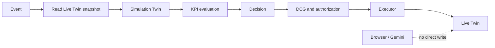
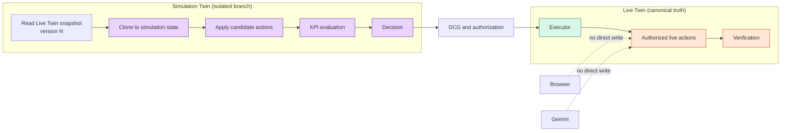

# RetailTwin AI — Domain and Data Model

## 1. Spatial hierarchy

`Store → Zone → Shelf → Slot → Product`

The 3D scene and backend use the same entity IDs. A visible product is therefore a representation of a domain entity, not a disconnected mesh.

## 2. Product state

Representative fields:

```json
{
  "product_id": "P017",
  "sku": "SKU-P017",
  "category": "beverages",
  "shelf_id": "A02",
  "slot_id": "A02-S03",
  "position": {"x": 1.2, "y": 1.4, "z": -0.5},
  "rotation": {"x": 0, "y": 0, "z": 0},
  "facings": 2,
  "shelf_quantity": 8,
  "backroom_quantity": 54,
  "price": 3.5,
  "promotion": null,
  "sales_velocity": 0.8,
  "forecast_demand": 22,
  "stockout_probability": 0.18,
  "version": 981,
  "updated_at": "2026-10-07T08:00:00Z"
}
```

Actual implementation may normalize fields into separate product/inventory/shelf documents, but APIs must present a coherent typed view.

## 3. Firestore responsibilities

Firestore is the operational state store for:
- stores;
- zones;
- shelves;
- slots;
- products;
- inventory;
- promotions;
- alerts/opportunities;
- simulations;
- AI action/decision state as needed.

Every mutable entity relevant to DCG should expose version and update time.

## 4. BigQuery responsibilities

Suggested tables:
- `sales_transactions` / `sales_events`;
- `inventory_history` / `inventory_events`;
- `product_performance`;
- `zone_traffic` when implemented;
- `promotion_history`;
- `shelf_performance`;
- `agent_actions`;
- `simulation_results`.

BigQuery is analytical/history storage; it is not the source of immediate 3D Live Twin coordinates unless an API explicitly materializes those values.

## 5. Store event

Minimum normalized event:

```json
{
  "event_id": "evt-000123",
  "correlation_id": "run-20261007-001",
  "event_type": "sale.completed",
  "store_id": "store-001",
  "sku": "P017",
  "quantity": 3,
  "occurred_at": "2026-10-07T08:01:00Z",
  "source": "synthetic-pos"
}
```

Events must be replayable in DEMO SCENARIO MODE and deduplicated by downstream consumers.

## 6. EvidenceBundle

Evidence is the factual input to planning.

```json
{
  "context_version": "store-001:v23871",
  "collected_at": "2026-10-07T08:02:00Z",
  "items": [
    {
      "type": "inventory",
      "entity_id": "P017",
      "version": "981",
      "observed_at": "2026-10-07T08:01:58Z",
      "value": {"shelf_quantity": 8, "backroom_quantity": 54}
    }
  ]
}
```

Mandatory evidence that cannot be obtained must result in an explicit insufficient-evidence state.

## 7. Supported read tools

MVP target set:
- `get_store_state()`
- `get_product_performance(sku)`
- `get_shelf_state(shelf_id)`
- `get_inventory(sku)`
- `get_backroom_inventory(sku)`
- `get_sales_history(sku, window)`
- `forecast_demand(sku, horizon)`
- `get_sales_velocity(sku)`
- `get_stockout_risk(sku)`
- `get_planogram()`

Optional:
- `get_customer_heatmap()`
- anomaly/traffic tools.

## 8. Supported simulation actions

MVP actions:
- `move_product(sku, from_slot, to_slot)`
- `change_facings(sku, facings)`
- `replenish_shelf(sku, quantity)`
- `create_simulation()`
- `compare_scenarios()`
- `calculate_business_impact()`

Later actions:
- `swap_products()`
- `create_promotion_display()`
- `change_price()`
- `apply_planogram()`

Sensitive actions should default to human review unless policy explicitly permits them.

## 9. Live action submission

Gemini does **not** call a generic live update.

Expected flow:

```text
proposed_actions
      ↓
Simulation Twin
      ↓
Decision
      ↓
submit_action_for_commit(decision)
      ↓
DCG
      ↓
commit authorization
      ↓
Executor
      ↓
exact allowed live actions
```

## 10. Live Twin / Simulation Twin isolation



Browser clients and Gemini may read approved views, propose plans, or invoke constrained tools. Neither may write Live Twin state directly; only the guarded Executor can apply an authorized action.

## 10.1 Live Twin vs Simulation Twin isolation



Simulation path: `Live snapshot/version → clone → simulation actions → KPI → discard/retain result`.
Live path: `Decision → DCG → authorization → Executor → Live state`.

MVP does not need a perfect retail economics model. It needs a transparent, reproducible one.

Candidate KPIs:
- stockout risk;
- shelf availability/service level;
- estimated demand coverage;
- movement/operational cost;
- business score.

Conceptual objective:

`score = α·RevenueBenefit + β·MarginBenefit + γ·ServiceLevel − δ·StockoutRisk − ε·MovementCost`

The coefficients/heuristics must be documented and deterministic for the demo dataset.

## 11. Data rules

- Do not hard-code the final winning scenario result into the UI.
- Synthetic data is acceptable but must travel through real system interfaces.
- Use deterministic seeds for reproducible demo runs.
- Preserve event, decision, simulation and action correlation IDs.
- Quantitative claims shown to judges must come from code/model output.
