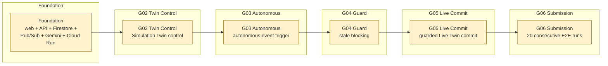

# RetailTwin AI — Implementation Guide

## 1. How a new developer should start

Before coding:
1. Read `docs/PROJECT_CONTEXT.md`.
2. Read `docs/CURRENT_STATUS.md` to distinguish current implementation from the target architecture.
3. Read `docs/ARCHITECTURE.md`.
4. Read `docs/DOMAIN_AND_DATA_MODEL.md`.
5. Read `docs/DEVELOPMENT_WORKFLOW.md` before preparing a pull request.
6. Read accepted records in `docs/adr/` that constrain the issue.
7. Identify your role below.
8. Open GitHub Issues filtered by your `role:*` label.
9. Follow dependencies in the issue before implementing it.
10. Do not add Competition-100 features while release gates are failing.

## 2. Critical path

Everything should support this path:

`Event → Agent → Evidence → Decision → Simulation → DCG → Executor → Live Twin → 3D → Verification`

When schedule is at risk, preserve this path and cut optional features.

## 3. Role A — AI / Agent / DCG

Primary responsibility: autonomous intelligence and safe decision execution.

Build:
- autonomous state machine;
- Gemini/Vertex AI integration;
- constrained Tool Registry;
- Observer;
- Investigator;
- Planner;
- Simulation orchestration;
- DCG;
- No-Stale-Commit;
- commit authorization;
- Executor;
- Verifier;
- automatic refresh/replan.

Rules:
- never give Gemini direct Live Twin write access;
- structured outputs/tools only;
- evidence is versioned;
- DCG is deterministic;
- fail closed;
- no hidden chain-of-thought storage.

## 4. Role B — 3D Digital Twin

Primary responsibility: make operational state spatially understandable and visibly executable.

Build:
- React/R3F scene;
- Store/Zone/Shelf/Slot/Product entity mapping;
- Firestore/API-backed state binding;
- product selection/highlight;
- `move_product` visualization;
- `change_facings` visualization;
- `replenish_shelf` visualization;
- separate LIVE/SIMULATION views;
- Current vs AI Proposal;
- agent-controlled camera.

Rules:
- backend Twin state is truth;
- animation alone is not a state mutation;
- Live and Simulation must be visually unambiguous;
- prioritize reliability over photorealism.

## 5. Role C — Data / ML / Google Cloud

Primary responsibility: data truth, event backbone, analytical numbers and cloud runtime.

Build:
- GCP project/IAM/budget/API foundation;
- Firestore schema/seed/reset;
- BigQuery tables;
- Pub/Sub events;
- deterministic synthetic POS/inventory scenario;
- anomaly signal;
- forecasting;
- stockout risk;
- simulation KPI evaluator;
- Cloud Run services;
- audit trail.

Rules:
- deterministic demo fixtures;
- LLM never invents KPIs;
- every relevant mutable entity has version/time;
- keep cloud configuration reproducible.

## 6. Role D — Integration / Product / UX

Primary responsibility: assemble a stable product and make autonomous behavior understandable.

Build:
- FastAPI/web integration;
- Agent Activity timeline;
- alert/opportunity UI;
- scenario comparison;
- DCG visualization;
- deterministic flagship demo controller;
- E2E tests;
- frontend deployment;
- reliability/error handling;
- README/docs/deck/video/submission.

This role owns integration quality, not only presentation.

## 7. Current implementation note

The phases below are delivery targets, not claims that those components already exist. `docs/CURRENT_STATUS.md` is authoritative for repository maturity. As of 2026-10-08, `main` has the view-only 3D scaffold from issue #3, the fixture-backed FastAPI plus frontend integration from issue #8, and the store-events backbone from issue #7. `POST /events` stays in memory and does not publish. `sale.completed` is claimed once in Firestore `store_event_claims`. The landing lease chooses who may submit the derived insert, and that insert uses one BigQuery job id for the claim generation. A replay is a duplicate. The API is not Firestore Live Twin, and a store event does not yet start the Observer. Issue #58 is closed. Firestore (#6), the Gemini read tool (#2), Cloud Run (#9), and Foundation Gate #10 through G06 remain open.

## 8. Build phases

### Phase 0 — Foundation
Target: web + API + Firestore + Pub/Sub + Gemini real tool + Cloud Run.

### Phase 1 — MVP-SAFE
Target: one autonomous event reaches Simulation Twin, passes/gets rejected by DCG correctly, and valid action reaches Live Twin + 3D.

### Phase 2 — SUBMISSION-80
Add complete verification/replan, 2–3 candidates, polished Agent Activity/DCG UI, multiple scenarios where time permits, deployment and submission artifacts.

### Phase 3 — COMPETITION-100
Only after stability: multi-agent ADK, advanced optimizer, customer heatmap, richer assets, rollback, vision or other enhancements.

## 9. Release-gate evidence



No gate is considered passed without repository-linked test, deployment, or run evidence. Current documentation describes acceptance criteria; it does not claim that Foundation or G02–G06 has passed.

Gate definitions: Foundation integrates web/API/Firestore/Gemini/Pub/Sub/Cloud Run; G02 proves Simulation Twin control; G03 proves autonomous trigger; G04 proves stale blocking; G05 proves guarded Live Twin commit; G06 proves 20 consecutive E2E runs.

Do not consider the project demo ready merely because individual services work.

## 10. Development conventions

- One issue should have one clear outcome.
- Reference issue number in PR/commit.
- Name the ADR the pull request tracks. Add or supersede a record in `docs/adr/` in the same pull request when the change creates or replaces an architecture decision. See `docs/adr/README.md`.
- Prefer small typed interfaces over implicit dictionaries.
- Add tests for failure paths.
- Use `.env.example`; never commit real secrets.
- Use structured logging with `correlation_id`, `decision_id`, `simulation_id`, `action_id`.
- Keep demo data resettable.
- A PR touching a public schema, state transition, tool or action contract, or security invariant must update the relevant docs and the ADR log in the same change.

## 11. Automatic scope reduction

If time is short:
1. Cut photorealistic assets.
2. Use one Gemini orchestrator instead of multi-agent.
3. Use deterministic forecasting fallback if BigQuery ML is unstable.
4. Use constrained candidate templates if advanced optimizer is unstable.
5. Preserve Pub/Sub autonomous trigger even if event source is synthetic.
6. Keep MVP DCG: version + freshness + constraints + permission.
7. Never cut Simulation-before-Live or No-Stale-Commit.

Minimum viable competition story:

**ONE 3D store + ONE autonomous event + ONE Gemini Agent + ONE investigation + ONE simulation + ONE DCG stale-context rejection + ONE automatic refresh/replan + ONE successful guarded commit + ONE visible 3D change.**

## 12. LLM Provider Architecture

The inference layer uses a **provider-neutral contract** (`apps/api/retailtwin_api/llm/contracts.py`).
All adapters implement `LlmProvider.complete(request: LlmRequest) -> LlmResponse`.

### Available providers

| Provider | Config key | Credentials | Use |
|---|---|---|---|
| `fake` | `LLM_PROVIDER=fake` | None | Tests, local dev, deterministic CI |
| `openai_compatible` | `LLM_PROVIDER=openai_compatible` | `LLM_BASE_URL`, `LLM_API_KEY` | Local proxies, third-party OpenAI-API-compatible endpoints |
| `vertex_gemini` | `LLM_PROVIDER=vertex_gemini` | GCP ADC (service account) | Production — Gemini on Vertex AI via Application Default Credentials |

### Using the fake provider

The fake provider returns pre-configured responses deterministically. No network call is made.

```python
from retailtwin_api.llm import FakeLlmProvider, LlmRequest, LlmMessage, LlmTool, LlmToolCall

provider = FakeLlmProvider(
    responses=[
        FakeLlmProvider.Response(content="Order 5 units."),
        FakeLlmProvider.Response(
            tool_calls=[
                LlmToolCall(id="call_1", name="order_item", arguments={"sku": "P017", "qty": 5})
            ],
            finish_reason="tool_calls",
        ),
    ],
)
response = await provider.complete(request)
```

In CI and tests, inject the fake provider so no real LLM is called.

### Adding a new provider

1. Create `apps/api/retailtwin_api/llm/<provider_name>.py` implementing `LlmProvider`.
2. Add `"<provider_name>"` to the `Literal` type in `LlmConfig.provider`.
3. Add the construction branch in `create_provider()` in `factory.py`.
4. Export from `llm/__init__.py`.
5. Add `test_llm_<provider_name>.py` with coverage for: success, error mapping, tool calls, structured output.
6. Document in this section and in `.env.example`.
